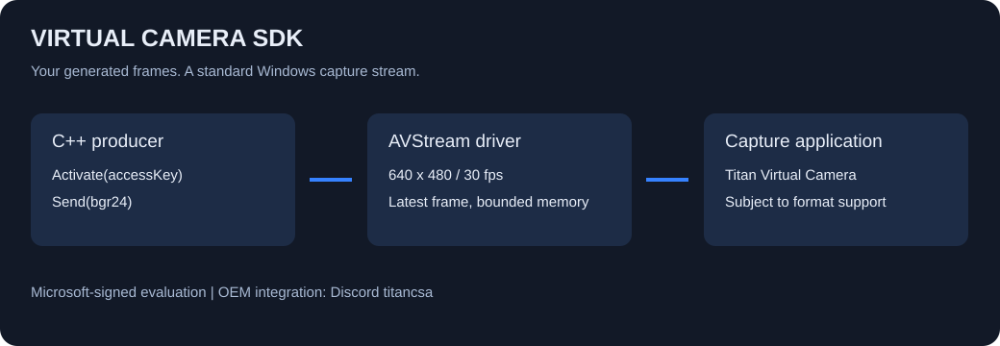

# Virtual Camera SDK

**A Windows AVStream kernel camera driver and compact C++ SDK for sending your own pixels to camera applications.**

Build a branded camera source, an automated video fixture, a generated teaching feed or a test integration. Your application supplies raw frames; Windows sees a camera capture stream. Contact **`titancsa` on Discord** for evaluation access, OEM distribution and integration support.



**Microsoft-signed evaluation bundle for Windows x64.** Application 0.1.1 includes the verified Microsoft-signed AVStream driver 0.1.0.0, self-contained UI and console installers, the native frame producer, C++ SDK and example sources. Public app/SDK source is MIT; the private driver has separate evaluation/commercial terms. See [validation](docs/VALIDATION.md) for the qualified boundary.

## The current contract

- One explicit producer, with a standard AVStream/Kernel Streaming camera capture device.
- Fixed **640 x 480, BGR24, 30 fps**; rows are bottom-up and tightly packed, stride 1,920 bytes.
- A persistent latest-frame buffer: a producer can send once or update continuously. Capture clients receive the latest image at the advertised cadence. There is no unbounded queue of stale frames.
- Administrator-only producer control and one owning file handle. Metadata-only and incomplete-access opens cannot claim the producer. Capture access follows Windows camera/device policy.
- Without an authorized producer, after its permission expires, or after it closes, consumers receive black frames. No physical webcam, microphone or desktop is captured.
- SDK errors include their stage and Windows error code. Network access occurs only for session authorization/renewal, never for each frame.

The driver uses documented Windows AVStream/KS facilities. It does not intercept an existing camera, hide devices, record video, install a browser extension or inject into capture applications. Resolution selection, multiple cameras, audio, GPU zero-copy and hardware encoding are not implemented in this preview.

## Install and run

1. Download and extract the complete **Microsoft-signed evaluation ZIP** from [Releases](https://github.com/titanfyre/Virtual-Camera-SDK/releases). Ask `titancsa` for a product-specific evaluation access key.
2. Run `VirtualCameraSetup.exe` as administrator. Choose **Install / reinstall**. Restart Windows only if setup requests it.
3. Open `CameraStudio.exe`, enter the access key and select **Start color bars**.
4. In your capture application, select **Titan Virtual Camera**. Camera privacy/device policy and capture-application format support still apply.
5. Select **Stop producer** or close the application to release ownership and return output to black. Uninstall through the setup UI or `VirtualCameraSetupConsole.exe /uninstall`.

Both setup executables embed the same signed INF, CAT and SYS; no separate driver download is required. Setup verifies the exact INF identity, the trusted Microsoft hardware-publisher catalog under Microsoft-root policy and INF/SYS catalog membership. It never enables test-signing, changes Secure Boot, restarts Windows automatically or touches another camera's package.

## Minimal C++ integration

```cpp
#include "Camera.h"

Camera camera;
if (auto error = camera.Activate(accessKey); !error.empty()) {
    // Display this English error; do not log the access key.
    return;
}
std::vector<unsigned char> pixels(CameraProtocol::FrameBytes, 0);
// Fill pixels with your own bottom-up BGR24 data.
if (DWORD error = camera.Send(pixels)) {
    auto message = Camera::Error(error);
}
// Keep camera alive; destroying it releases the producer.
```

Compile `SDK/Camera.cpp` and include `SDK/Camera.h`; the small protocol headers live beside them. C++20 and the Windows SDK are required. Link WinHTTP and Crypt32 (the source also supplies MSVC library pragmas). `Camera::Query(state)` reads submitted/delivered counters and the authorization state. `Camera::Close()` explicitly releases ownership.

Serialize frame sends on an object. Call the first `Activate()` before sending; subsequent `Activate()` calls can renew an established session while its producer continues to send. Keep the object alive until renewal has finished. The studio example renews after 45 minutes on a background thread, retains its key only in process memory while running, retries temporary transport failures after a minute, and stops if permission is refused. It stores no key or configuration file. The short console example authorizes one session and holds one generated image until Enter.

## Product access and OEM distribution

Each product has independent application access keys in the shared administration portal. An enabled key with an evaluation, commercial or OEM entitlement can request a signed session permission over HTTPS. The driver generates a random challenge, verifies the P-256 signature and checks that the permission matches this product and the current producer session. Permissions last at most one hour from driver acceptance and can be renewed. This is a renewable session lease, not a one-hour total demo timer. Revoking a key blocks future grants; an already granted session can remain active until its permission expires.

Evaluation access, paid time-limited pilots, per-customer SDK integration, OEM deployment agreements and support can use the same installer. Commercial rights and deployment counts are contractual: this design does **not** implement a machine fingerprint, offline machine-count enforcement, per-EXE authorization or guaranteed resistance against an administrator/kernel attacker. Keys must not be embedded in public examples. No private signing key is shipped in the driver or SDK. Authorization sends the access key, product identifier and a random session challenge to the licensing service; the service also sees the connection IP. It receives no video frames or machine fingerprint from this SDK.

The business offering is deployment/integration support and a documented raw-frame SDK. Free alternatives already exist: [OBS Virtual Camera](https://obsproject.com/kb/virtual-camera-guide) and [Windows 11 Media Foundation virtual cameras](https://learn.microsoft.com/en-us/windows/win32/api/mfvirtualcamera/nf-mfvirtualcamera-mfcreatevirtualcamera). A custom kernel driver is not necessary for every virtual-camera project. Windows 10/11 AVStream integration is the target of this implementation, subject to actual qualification.

## Build

The target platform is Windows 10 build 19041 or later, or Windows 11, x64; the live campaign currently covers Windows 10 build 19045 only. Use Visual Studio 2022 C++ desktop tools, CMake 3.20+ and the Windows SDK to build:

```powershell
.\Build.ps1
.\Build.ps1 -Asan
```

Outputs are in `obj/Build/Release`. Public source builds contain no driver payload and cannot install a driver. For authorized packaging of an already-signed return:

```powershell
cmake -S . -B obj/Package -G "Visual Studio 17 2022" -A x64 -DDRIVER_PACKAGE_DIRECTORY="C:/Signed/TitanVirtualCamera"
cmake --build obj/Package --config Release
```

That directory must contain the matching `TitanVirtualCamera.inf`, `.cat` and `.sys`. Both setup executables embed all three files. Console setup accepts `/install` and `/uninstall`; exit code **3010** requests a manual restart.

## Validation and limits

The returned Microsoft-signed driver passed isolated Windows 10 build 19045 x64 campaigns normally and under standard Driver Verifier, with test-signing disabled. Each campaign passed **499 real-KS/frame/lifecycle checks** and **67 two-second signed-permission expiry checks**. They included 256 frame submissions, 16 capture open/close cycles, black fallback, producer ownership and restricted/incomplete-access refusal. The bundled console installer completed installation and exact device/package removal; the installed Driver Store SYS matched the signed return, the camera driver unloaded and no new minidump was observed. UI setup shares that core; its signed resources were separately compared byte for byte, rather than claiming automated UI interaction.

Offline checks cover 100,010 protocol cases, 11 basic identity/trust checks and 25 actual signed-package acceptance/tamper-refusal checks; protocol AddressSanitizer also passes. See [validation](docs/VALIDATION.md) for measured boundaries. Windows 11, representative capture applications/browser permission paths, GPU/camera-stack coexistence and long-duration operation remain unqualified. A signature and bounded tests do not establish universal compatibility, physical latency, WHQL certification or absence of defects.

## License and responsible use

Public app, SDK, examples and installer source: [MIT](LICENSE). The driver is private with separate evaluation/OEM terms. Retained [Microsoft sample notices](docs/DRIVER-NOTICES.txt) and the [MS-PL](docs/LICENSE-Microsoft-Driver-Sample.txt) apply to upstream portions. Microsoft signing is not a product endorsement or WHQL certification.

Use only on systems you own or administer with authorization, for legitimate testing, accessibility, video production and integration. Follow applicable law and third-party terms. To the extent permitted by law, the author is not responsible for misuse, unlawful activity or resulting damage; software is supplied without warranty. Mandatory statutory rights and non-excludable liability remain unaffected.
